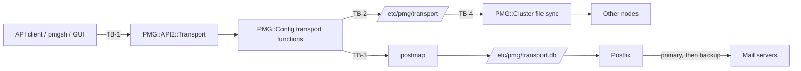

# Architecture: pmg-api fork

This file owns HOW the fork is built: its components, boundaries, technology, and data flow. `REQUIREMENTS.md` owns WHAT the fork does. `DESIGN.md` owns API and command-line conventions. `SECURITY.md` owns the detailed controls. This describes the upstream design as found in the code at commit `e889c13` (version 9.1.6, Debian trixie), and marks where the fork changes it.

Facts below were read from the repository on 2026-11-16 unless a source is named.

## Required Architecture Inputs

- **Requirements and design sources:** `REQUIREMENTS.md` (FR-1 to FR-4, NFR-1 to NFR-4); `DESIGN.md`.
- **Target surfaces:** REST API (daemon `pmgdaemon`, proxied by `pmgproxy`), the `pmgsh` shell, and CLI tools in `src/PMG/CLI`. Background services: `pmgmirror`, `pmgtunnel`, and the SMTP filter and policy daemons. The fork changes none of the services.
- **Runtime and deployment environment:** a Proxmox Mail Gateway node on Debian trixie, built as the Debian package `pmg-api` (architecture `all`). CONFIRMED.
- **Server framework:** Perl with `PVE::RESTHandler` and `PVE::JSONSchema` from `libpve-common-perl`. CONFIRMED (upstream).
- **Client frameworks:** N/A here. The web GUI is the separate `pmg-gui` repository (RQ-3).
- **API style:** REST with JSON schema, methods registered with `register_method` (`name`, `path`, `method`, `permissions`, `parameters`, `returns`, `code`).
- **Authentication and session model:** PMG ticket authentication and roles, owned by upstream (`PMG::AccessControl`). Not changed.
- **Outbound calls:** `postmap` (local program), Postfix reading `/etc/pmg/transport.db`. No network calls added.
- **Authorization model:** each method declares `permissions => { check => [...] }` with `admin` for changes and `admin`/`audit` for reads. Not changed.
- **Data store and expected scale:** flat files under `/etc/pmg`, read and written through `PVE::INotify` registered files. Entry counts are small (one per relay domain). PostgreSQL holds mail statistics and rules, not transport entries.
- **Logging library or platform logger:** `PVE::SafeSyslog` and Perl `warn`.
- **Security expectations:** owned by `SECURITY.md`.

## Stack

| Technology | Version line | Justification | Status |
|---|---|---|---|
| Perl | the version in Debian trixie (`perl (>= 5.10.0-19)` in `debian/control`) | Upstream language. | CONFIRMED |
| `libpve-common-perl` (`PVE::RESTHandler`, `PVE::JSONSchema`, `PVE::INotify`, `PVE::Tools`) | `>= 9.1.8~` per `debian/control` | API registration, parameter schemas, config file registry, safe command execution. | CONFIRMED |
| Template Toolkit (`libtemplate-perl`) | trixie | Renders `src/templates/*` (including `main.cf.in`) into Postfix configuration. | CONFIRMED |
| Postfix | `>= 3.7.10` per `debian/control` | MTA that reads `/etc/pmg/transport`. Multiple destinations in one nexthop need Postfix 3.5 or later (Postfix `transport(5)`, as quoted in the Proxmox forum thread). | CONFIRMED |
| `proxmox-perltidy` | as packaged by Proxmox | Code style (`make tidy`). | CONFIRMED |
| `dpkg-buildpackage`, `lintian`, `sbuild` | trixie | Package build and checks (`make deb`, `make dsc`, `make sbuild`). | CONFIRMED |

The fork adds no dependency (NFR-2.2).

## Components and Flows

Everything runs inside the upstream daemons on a PMG node. The fork changes two files.

| Component | Responsibility | Business rules enforced | Data owned | Requirement IDs | Status |
|---|---|---|---|---|---|
| `PMG::API2::Transport` (`src/PMG/API2/Transport.pm`) | REST methods: index, create, read, write, delete for transport entries | FR-1.2 to FR-1.6, FR-2.1 to FR-2.4; role checks; master-only writes (`proxyto => 'master'`) | None | FR-1, FR-2, FR-3.1 | CHANGED in fork |
| `PMG::Config` transport functions (`read_transport_map`, `write_transport_map`, `pmg_verify_transport_address`, `postmap_pmg_transport`) | Parse and write `/etc/pmg/transport`; address validation; rebuild lookup table; compute trusted networks from entry hosts | FR-1.1, FR-1.7 to FR-1.11 | `/etc/pmg/transport` | FR-1 | CHANGED in fork |
| `PMG::Utils::run_postmap` | Runs `/usr/sbin/postmap` on the file when it is newer than its `.db` | None | `/etc/pmg/transport.db` | FR-1.7 | UNCHANGED |
| `PMG::Cluster` file sync | Copies `/etc/pmg/transport` from the master to other nodes | FR-3.2 | None | FR-3 | UNCHANGED |
| `src/templates/main.cf.in` | Points Postfix at `hash:/etc/pmg/transport` (`transport_maps`) and `hash:/etc/pmg/domains` (`relay_domains`) | None | None | FR-1.12 | UNCHANGED |
| Postfix | Delivers mail, trying destinations in order | FR-1.12 | Mail queue | FR-1.12 | EXTERNAL |

### Main data flows

1. **Change an entry:** client → `pmgproxy`/`pmgdaemon` → `PMG::API2::Transport` (permission check, schema validation, master-only) → `lock_config` → `PVE::INotify::read_file('transport')` → change in memory → `PVE::INotify::write_file('transport')` → `postmap_pmg_transport` → `postmap` rebuilds `transport.db`.
2. **Sync:** cluster master → `PMG::Cluster` copies `transport` to other nodes → each node rebuilds its `.db`.
3. **Deliver:** Postfix looks up the recipient domain in `transport.db`, tries the primary destination, then the backup (FR-1.12).
4. **Trusted networks:** when the Postfix config is rendered (`PMG::Config`, `mynetworks` and `transportnets` from entry hosts), IP hosts of the primary and the backup are added (FR-1.11).

### Trust boundaries and enforcement points

- **TB-1 API client ↔ pmgdaemon.** Authentication, role check, and parameter schema validation happen before a method body runs. The method body trusts only validated values.
- **TB-2 PMG process ↔ files in `/etc/pmg`.** All reads and writes go through `PVE::INotify` registered files, under `lock_config`. Values written must already have passed a registered format (SC-004).
- **TB-3 PMG process ↔ Postfix and `postmap`.** The only command run is `postmap` with a fixed path and the file name as a list argument (`PVE::Tools::run_command`). No shell is involved.
- **TB-4 Node ↔ node (cluster).** The master pushes files. A node does not accept transport changes through its own API (`proxyto => 'master'`).
- **TB-5 Fork ↔ upstream.** Code from upstream is merged into the fork; code sent upstream must carry only the fork's commits (FR-4).

## Dependency Rules

- **DR-1** API modules (`PMG::API2::*`) call `PMG::Config` and `PVE::*` helpers. `PMG::Config` does not call API modules.
- **DR-2** File format knowledge (how a transport line looks) lives only in `PMG::Config` (`read_transport_map`, `write_transport_map`). API modules do not parse or format file lines.
- **DR-3** Validation rules live in registered formats (`PVE::JSONSchema::register_format`) in `PMG::Config`, and API parameters name them with `format`. An API module does not re-implement them.
- **DR-4** Changes to files under `/etc/pmg` happen only inside `PMG::Config::lock_config`.
- **DR-5** External programs run only through `PVE::Tools::run_command` with a list of arguments.
- **DR-6** The fork changes the smallest set of upstream files that satisfies the requirement (FR-4.2). New helper code goes next to the code it supports.

## Diagrams

## Toolchain

Run these from the repository root. Commands that need Proxmox packages (`libpve-common-perl`, `proxmox-perltidy`, `lintian`, `sbuild`) work only on a Proxmox or Debian machine with the Proxmox development repository. They are not available in the Claude workspace.

| Check | Command | Notes |
|---|---|---|
| Install build dependencies | `apt build-dep pmg-api` or `mk-build-deps` on `debian/control` | Needs the Proxmox repository |
| Format | `make tidy` | Runs `proxmox-perltidy` on all `.pm` and `.pl` files (NFR-4.2) |
| API check | `perl -I src src/bin/pmgsh verifyapi` | The same check `make -C src install` runs (FR-2.5) |
| Unit and integration tests | `make -C src/tests check` | Integration tests are skipped inside `sbuild` (`SKIP_INTEGRATION_TESTS`) |
| Build package | `make deb` | `dpkg-buildpackage -b -us -uc`, then `lintian` (NFR-4.3) |
| Build source package | `make dsc` | |
| Syntax check of one module | `perl -I src -c src/PMG/Config.pm` | Needs the PVE modules installed |

## Open Questions

- **AQ-1** Where do the new tests live? The proposal is `src/tests/test_transport_map.pl`, added to the `check` target in `src/tests/Makefile` (NFR-4.1). Not built yet.
- **AQ-2** The default relay (`pmg.mail.relay`, FR-1 baseline for domains without a transport entry) has no backup field. Decide whether the backup concept should extend to it. Not required now.
- **AQ-3** Whether to fork `pmg-gui` (RQ-3).
